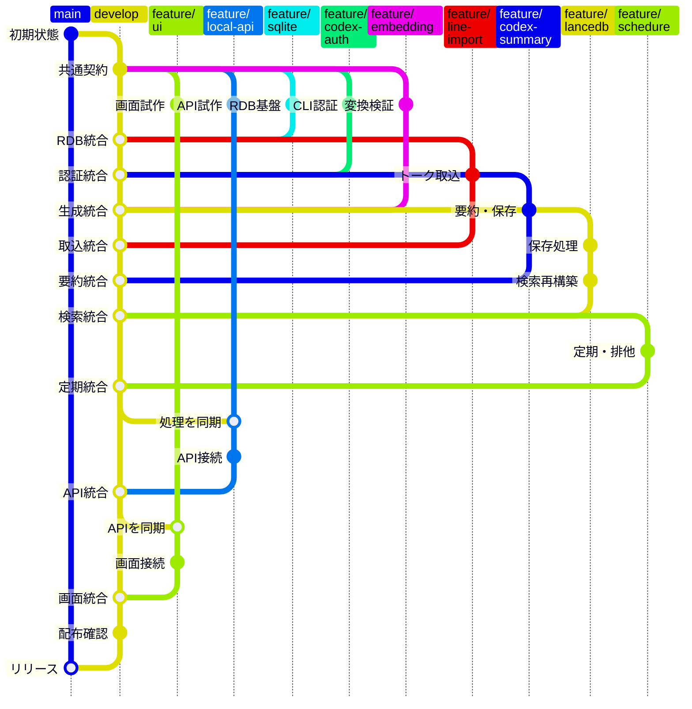

# tech-chat-notes
技術関連チャットのノート化 / 相談があったり回答があったりした技術的内容を、自動的にまとめてノート化(QandAのように可視化)する Windows 向けデスクトップアプリを目標とする。利用者が各自ダウンロードしてローカルで使用する。

## ドキュメント

| 分類 | ドキュメント | 内容 |
| :--- | :--- | :--- |
| 要件 | [機能要件・非機能要件](docs/requirements/機能要件・非機能要件.md) | 提供する機能と運用上の前提 |
| 要件 | [技術スタック選定・システム構成](docs/requirements/技術スタック選定・システム構成.md) | 技術候補の比較、採否、未決事項 |
| 要件 | [システム構成図](docs/requirements/システム構成図.md) | 画面・処理・データの責務と流れ |
| 要件 | [ローカル Embedding モデル選定](docs/requirements/ローカルEmbeddingモデル選定.md) | 意味検索モデルの候補と評価項目 |
| 要件 | [生成 AI の調査メモ](docs/requirements/生成AIの調査文.md) | Codex の接続方式に関する調査記録 |
| 仕様 | [画面仕様書](docs/specifications/画面仕様書.md) | 画面と操作、画面モック |
| 仕様 | [API 仕様書](docs/specifications/API仕様書.md) | ローカル HTTP エンドポイントと入出力 |
| 仕様 | [DB 仕様書](docs/specifications/DB仕様書.md) | テーブル案と論理・物理 ER 図 |

## ブランチ運用

| ブランチ | 用途 |
| :--- | :--- |
| `main` | <ul><li>配布・公開できる状態の保持</li><li>develop からリリース対象を取り込む</li></ul> |
| `develop` | <ul><li>次のリリースに向けた変更の統合</li><li>作業ブランチのマージ先</li></ul> |
| `feature/ui` | <ul><li>取込・要約・一覧・検索・設定画面の実装</li><li>入力と処理結果の表示</li></ul> |
| `feature/schedure` | <ul><li>アプリ起動中の定期要約</li><li>対象日と実行タイミングの判定</li></ul> |
| `feature/sqlite` | <ul><li>RDB のスキーマとマイグレーション</li><li>通常データの保存・取得</li></ul> |
| `feature/lancedb` | <ul><li>ベクトルの保存・検索・削除</li><li>検索用データの再構築</li></ul> |
| `feature/line-import` | <ul><li>LINE .txt の解析と入力検証</li><li>重複判定と取込処理</li></ul> |
| `feature/codex-auth` | <ul><li>Codex CLI の配置確認</li><li>OAuth 認証の開始・状態確認</li></ul> |
| `feature/codex-summary` | <ul><li>Codex CLI による要約</li><li>結果の保存と失敗時の処理</li></ul> |
| `feature/embedding` | <ul><li>ローカルモデルの読込</li><li>要約・検索文のベクトル化</li></ul> |
| `feature/local-api` | <ul><li>HTTP エンドポイントの実装</li><li>入力検証と応答形式の整備</li></ul> |

依存する機能の統合順序と、並行開発を示す運用について記載する。

- SQLite の保存・取得機能を統合してから、トーク取込を実装する。
- SQLite と Codex 認証を統合してから、要約の実行・保存を実装する。トーク取込と要約の開発は、共通のメッセージ形式を決めれば並行できる。
- SQLite と Embedding を統合してから、LanceDB の登録・検索・再構築を連携させる。Embedding モデルは評価後に決め、ベクトル次元などの契約を揃える。
- 要約処理を統合してから、定期処理でその処理を呼び出す。手動実行との競合防止もここで扱う。
- UI とローカル API は共通の入出力仕様を決め、モックを使って先に着手できる。バックエンド統合後に API を実処理へ接続し、最後に UI を API に接続する。



依存する機能は `develop` を経由して共有する。先に着手した UI・API ブランチには、必要な機能が統合された時点の `develop` を取り込む。図のマージ順は開発手順の例であり、アプリの実行時には「取込 → 要約 → ベクトル生成・保存 → 検索」の流れになる。

作業ブランチの変更は `develop` に取り込み、リリース対象を確認してから `main` に反映する。不具合修正は内容に応じて同じ作業単位のブランチで扱う。公開済みの `main` を緊急修正する必要が生じた場合のみ `hotfix/<作業名>` を作り、修正を `main` と `develop` の両方へ反映する。`release/*` はリリース準備を別ブランチで並行する必要が出るまで設けない。

この運用は、統合ブランチと短期の作業ブランチを使う [Git のブランチ運用例](https://git-scm.com/book/en/v2/Git-Branching-Branching-Workflows)を参考にした。

## Python での開発開始手順（Windows / PowerShell）

現在の `main.py` は開発用の起動画面です。取込・要約・検索などの機能は実装途中です。

1. [Python 公式の Windows 向け配布ページ](https://www.python.org/downloads/windows/)から Python 3.13 の 64-bit インストーラーをダウンロードして実行します。インストーラーに「Add python.exe to PATH」が表示された場合は有効にします。
2. 新しい PowerShell を開き、Python を確認します。

   ```powershell
   py -3.13 --version
   ```

3. [Poetry 公式の Windows 向け手順](https://python-poetry.org/docs/#installation)で Poetry を導入します。

   ```powershell
   (Invoke-WebRequest -Uri https://install.python-poetry.org -UseBasicParsing).Content | py -3.13 -
   ```

   PowerShell を開き直して `poetry --version` を確認します。コマンドが見つからない場合は、Poetry の公式手順に従って `%APPDATA%\Python\Scripts` を `PATH` に追加します。

4. このリポジトリを取得してルートに移動し、`pyproject.toml` に指定したライブラリを導入します。

   ```powershell
   git clone https://github.com/maro-syachiku/tech-chat-notes.git
   cd tech-chat-notes
   poetry install
   ```

   既にリポジトリを取得済みなら、ルートで `poetry install` だけ実行します。Python 3.13 以外の環境が選ばれた場合は、`poetry env use` で Python 3.13 の実行ファイルを指定してから再実行します。

5. メインウィンドウを起動します。

   ```powershell
   poetry run python .\src\tech_chat_notes\main.py
   ```

起動すると「tech-chat-notes の開発用起動画面」と表示されます。SQLite は Python 標準ライブラリを使用します。Embedding モデルと Codex の接続方式は未決定のため、この起動画面では使いません。


## 現在の設計方針

- Windows 向け portable デスクトップアプリとして開発する。
- CustomTkinter、SQLite、LanceDB Embedded、PyInstaller を初期構成として採用する。
- 意味検索の Embedding はローカル実行を前提とし、モデルは評価後に確定する。
- 要約には Codex を使う。アプリから呼び出す接続方式と認証方式は未決定。トーク本文を外部送信する範囲と送信先を利用者に示す。
- LINE トークは利用者が保存した `.txt` から取り込み、LINE API には接続しない。

詳しい前提と未決事項は各要件・構成資料を参照してください。候補や設計案は、採用・実装済みと明記されていない限り確定仕様ではありません。

## お知らせ

* issue上のやり取りが持つ公開範囲は、リポジトリが持つ公開範囲を引き継ぐらしいです。
* そのため、このリポジトリは一時的にプライベートとしています。
* 最終的には「ソースコード公開用の別リポジトリを作成する」「このリポジトリはパブリックでも問題ない」の2択を検討する必要があると思われます。
