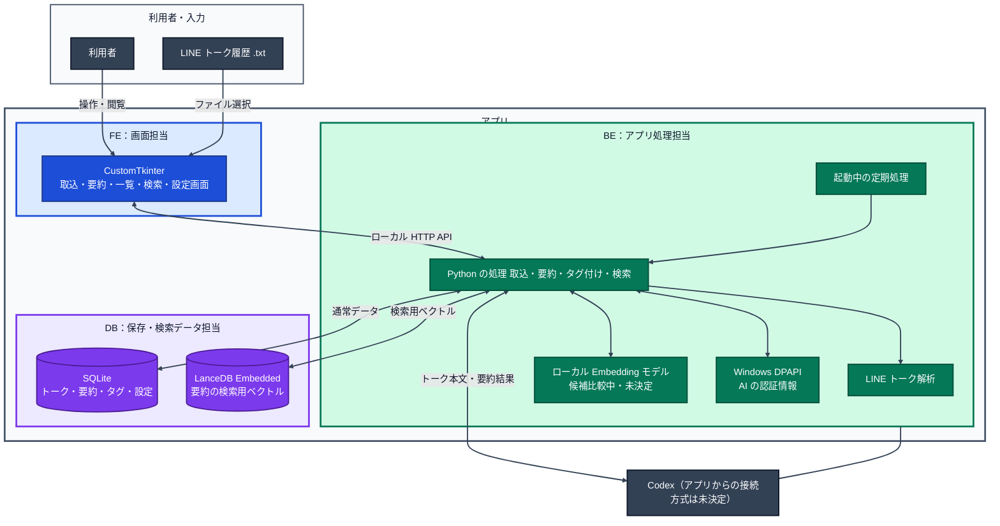
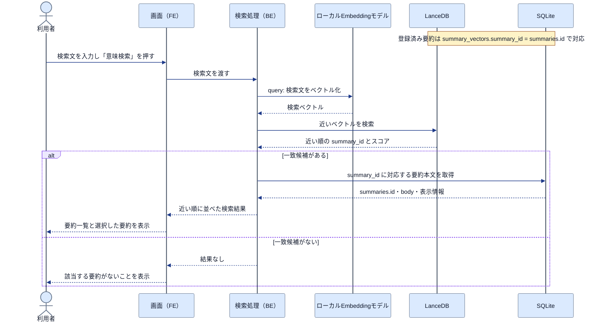

# システム構成図

画面（FE）、アプリ内の処理（BE）、データ保存（DB）の担当範囲と各領域の設計案を示します。
[機能要件・非機能要件](./機能要件・非機能要件.md)と[技術スタック選定・システム構成](./技術スタック選定・システム構成.md)を前提とした記載です。

## 1. 全体構成図



「アプリ」の外枠に FE・BE・DB を含め、利用者・トーク履歴・Codex は枠外に示す。FE・BE・DB は担当範囲を示す区分で、別々の配布物ではない。画面と処理の境界にはアプリ内で起動するローカル HTTP API を設計し、`127.0.0.1` のみで待ち受ける案とする。ポート・認証・起動方法は未決定。配布には PyInstaller を使う方針。Embedding とベクトル検索はローカルで行う。

| 区分 | 主な責務 | 担当間の境界 |
| :--- | :--- | :--- |
| フロントエンド | 操作、入力確認、一覧・詳細・進捗・エラー表示 | BE に処理を依頼し、結果を表示する |
| バックエンド | トーク解析、処理順序、要約、Embedding、定期処理、認証情報の利用 | FE と DB の間で処理を組み立てる |
| データベース | SQLite のスキーマ・移行・制約、LanceDB のデータ形式・検索・再構築 | SQLite を通常データの正本とし、LanceDB は再生成できる検索データにする |





## 2. FE：画面設計案

**技術：** Python と CustomTkinter。表形式の表示で不足する部品があれば ttk との併用を検討する。

メインウィンドウを一つだけ開き、左側のメニューから中央の表示を切り替える。ファイル選択や確認にはダイアログを使うが、機能ごとの別ウィンドウは作らない方針。

| 画面 | 利用者の操作 | BE とのやり取り |
| :--- | :--- | :--- |
| トーク取込 | `.txt` を選択し、取込結果を確認する | ファイルパスを渡し、件数やエラーを受け取る |
| 要約一覧・詳細 | 要約を閲覧し、タグ・ブックマークを操作する | 一覧・本文・分類情報を取得・更新する |
| 要約実行 | 手動実行と進捗確認を行う | 実行を依頼し、状態を受け取る |
| 検索 | 検索文を入力し、近い要約を開く | 検索結果の順位と本文を受け取る |
| 設定 | AI の送信先と送信内容を確認し、認証情報を登録する | BE に設定変更を依頼する |

画面モックは[画面仕様書](../specifications/画面仕様書.md#画面モック初期案)を参照。

AI 呼び出しや大量の Embedding 処理は画面操作を塞がない形で実行し、進捗と失敗を表示する。

## 3. BE：バックエンド処理

**技術：** Python。バックエンドは画面からの依頼を受け、次の処理を行う。

| 処理 | 概要 |
| :--- | :--- |
| トーク取込 | LINE の `.txt` を解析し、形式と重複を確認して SQLite に保存する |
| 要約実行 | 未要約トークを選び、送信内容を確認したうえで外部生成 AI に依頼し、結果と実行履歴を保存する |
| 定期処理 | アプリ起動中に未要約トークを確認し、要約処理を開始する |
| 要約・分類管理 | 要約の閲覧・編集・削除、タグとブックマークの更新を行う |
| ベクトル生成 | ローカル Embedding モデルで要約文を変換し、LanceDB のデータを追加・更新・削除する |
| 意味検索 | 検索文をローカルでベクトル化し、LanceDB で近い要約 ID を探して SQLite の本文を取得する |
| 設定・認証情報 | 秘密でない設定を保存し、AI の認証情報を Windows DPAPI で保護する |
| エラー・復旧 | 失敗状態を記録し、再実行や SQLite からのベクトル再構築に対応する |

## 4. フォルダ構成

以下は FE・BE・DB の担当箇所を示す配置案。`main.py` の起動用画面のみ作成済みで、それ以外は未実装。

```text
src/tech_chat_notes/             # 提案するパッケージ構成。一部のみ作成済み
├─ main.py                      # 起動と依存の組み立て
├─ ui/                          # FE 担当：画面と表示用の状態
│  ├─ import_view.py
│  ├─ summary_view.py
│  ├─ summarize_view.py
│  ├─ search_view.py
│  └─ settings_view.py
├─ application/                 # BE 担当：操作ごとの処理
│  ├─ import_chat.py
│  ├─ summarize.py
│  ├─ manage_summaries.py
│  └─ search_summaries.py
├─ domain/                      # BE 担当：メッセージ・要約などのデータ型
├─ infrastructure/              # BE と DB の接続部分
│  ├─ line_parser.py
│  ├─ ai_client.py
│  ├─ local_embedder.py
│  ├─ credentials.py
│  ├─ sqlite_repository.py
│  └─ lancedb_repository.py
└─ scheduler.py                 # BE 担当：起動中の定期実行
migrations/                     # DB 担当：SQLite のスキーマ変更
models/                         # 配布する Embedding モデル
data/                           # 実行時に作成する利用者データ。Git に含めない
├─ app.sqlite
└─ lancedb/
```

`ui` は[ローカル API](../specifications/API仕様書.md)を通じて `application` の処理を呼び、`application` は具体的な保存操作を `infrastructure` に任せる。DB 担当は `migrations` と保存形式を定義し、BE 担当と読み書きの契約を合わせる。

## 5. リレーショナルデータベース設計

**技術：** Python 標準の `sqlite3` とローカルの SQLite ファイル。トーク・要約・タグ・ブックマーク・処理履歴・秘密情報を含まない設定を保存し、スキーマは SQL マイグレーションで管理する。

各テーブルの ID は Python の `str(uuid4())` で生成する UUID v4 とし、SQLite では `TEXT` に保存する。主キー列は `TEXT PRIMARY KEY`、対応する外部キー列も `TEXT` とする。`settings.key` は設定名をそのまま使う自然キーなので UUID にしない。SQLite と LanceDB の要約 ID は同じ文字列を使用する。

論理名・物理名の ER 図と型の説明は[DB 仕様書](../specifications/DB仕様書.md#論理名er図)を参照。

## 6. ベクトルデータベース設計

**技術：** ローカルの LanceDB Embedded と[ローカル Embedding モデル](./ローカルEmbeddingモデル選定.md)。LanceDB は意味検索用のデータを保持し、要約本文と管理情報は SQLite に置く。

 `summary_vectors` の列 | 役割 |
| :--- | :--- |
| `summary_id` | SQLite の `summaries.id` と同じ UUID 文字列 |
| `embedding_model` | ベクトルを生成したモデルの識別子・版 |
| `vector` | 要約文から得た固定長の数値列。初期候補は 384 次元 |

### SQLite と LanceDB の対応・検索手順

SQLite の `summaries` が**要約本文の保存先**で、LanceDB の `summary_vectors` はその要約を探すための**ベクトルと要約 ID の保存先**になる。両者は `summaries.id = summary_vectors.summary_id` で対応する。

| 保存先 | 例 | 用途 |
| :--- | :--- | :--- |
| SQLite `summaries` | `id = "550e8400-e29b-41d4-a716-446655440000"`, `body = "認証エラーの原因と対処…"` | 表示する要約本文を保持する |
| LanceDB `summary_vectors` | `summary_id = "550e8400-e29b-41d4-a716-446655440000"`, `vector = [0.12, …]` | 意味が近い要約を探し、対応する ID を返す |

検索前の登録処理では、SQLite に要約本文を保存する。同じ本文をローカル Embedding モデルでベクトル化し、SQLite の要約 ID とともに LanceDB に保存する。検索時に作る検索ベクトルは通常は保存しない。LanceDB が `summary_id` を返したら、BE は同じ UUID 文字列を持つ SQLite の `summaries.id` から本文を取得する。

LanceDB の `summary_id` は SQLite の主キーを参照する値だが、**二つの DB をまたぐ外部キー制約はない**。対応の維持と、不一致が起きたときの再構築は BE の責務とする。ここで表示する「文章」は生成された**要約本文**であり、元の LINE メッセージ本文を直接検索・表示する設計ではない。

初期案は**要約 1 件につきベクトル 1 件**とする。入力上限を超える要約の分割方法は未決定で、分割する場合は `chunk_id` などを追加して複数ベクトルにする。要約の編集・削除やモデル変更時は検索用データを更新または再構築する。E5 の指定に従って要約に `passage: `、検索文に `query: ` を付ける。

## 7. 実装前に決めること

- LINE 保存ファイルの形式差、タイムゾーン情報がない日時の解釈、重複識別値、複数取込と会話の対応。
- 要約の単位と、入力上限を超える要約の分割・ベクトル保持方法。
- 日本語の実データを使ったモデルの精度、CPU 上の速度、Windows 配布物での動作。
- Codex の接続方式、送信範囲、認証情報の登録方法。
- 定期処理の間隔、バックアップ・復元の手順。

## 参考資料

- [CustomTkinter](https://github.com/TomSchimansky/CustomTkinter)
- [Python sqlite3](https://docs.python.org/3/library/sqlite3.html)
- [LanceDB Embedded](https://docs.lancedb.com/)
- [Multilingual E5 small モデルカード](https://huggingface.co/intfloat/multilingual-e5-small)
