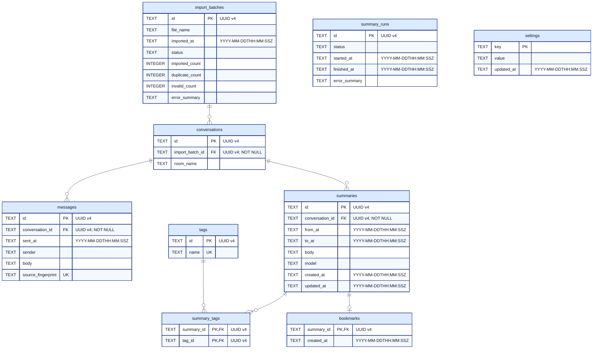
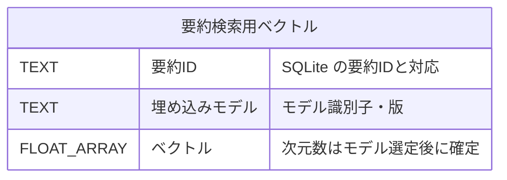
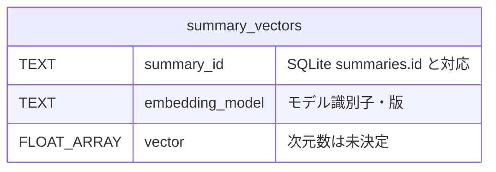

# DB 仕様書

## 保存先と責務

SQLite はトーク・要約・タグ・設定などの正本、LanceDB Embedded は要約から再構築できる検索用データを保持する。DB とマイグレーションは未実装。認証情報は通常の SQLite 設定に保存せず、Windows DPAPI で保護する方針。

## SQLite 設計

### 確定した処理規則と物理設計の残件

- 要約に実際に使ったメッセージの内部 ID を記録する。期間だけで使用済みと判定しない。
  再要約では対象範囲内の追加メッセージを含め、成功時に使用メッセージの対応も更新する。
  実行開始時に対象を固定し、開始後の追加分は今回の使用済みに含めない。
- AI が生成した要約原文と、利用者に表示する編集後の本文を区別して保持する。
  手編集で AI 原文を失わず、利用者の操作で AI 原文へ戻せるようにする。
  手編集した要約の自動更新保護は、明示的な再要約の後も維持する。
  AI 原文への復元では外部 AI を呼び出さない。
  過去の AI 原文を世代選択する一般向け機能は設けない。内部設計は複数世代を保持できる構造とし、
  保持世代数・削除条件は別途定める。最新の AI 原文へ戻す既決の操作とは区別する。
- 要約実行履歴と、作成・更新した現在の要約を関連付ける。生成失敗時は既存本文と
  既存の使用メッセージの対応を保持する。
- 要約本文の保存と検索への反映を別の状態として管理する。ベクトル生成失敗時も
  SQLite に保存した本文は保持し、検索への反映を「未完了」として再生成できるようにする。
  要約単位の本文を SQLite に保存した時点で、その要約は完了とする。
  ベクトル生成の成否は別に記録し、失敗しても保存済み要約を未完了に戻さない。
  新規要約の作成時は、処理の一部として初回ベクトル生成まで実行する。
  既存要約の本文変更（手編集・再要約・AI 原文への復元）後は、
  変更した要約自身のベクトルを再生成する。失敗時は本文を保持し、検索反映を未完了にする。
  その要約を参考に作られた後続日の要約本文とベクトルは、変更に連鎖して更新しない。
  本文を変更した時点で検索反映を未完了とし、以前の本文から生成したベクトルと区別する。
- 要約削除時は要約へのタグ付けとブックマークも削除する。ほかの要約が使うタグ自体や
  元メッセージはこの操作で削除しない。

以下の ER 図・列一覧は初期案。上記を表現する使用メッセージの関連、AI 原文、
自動更新保護、検索反映状態、実行結果の関連の物理列・テーブルは次の設計で追加する。
要約の単位はオプチャ名・日本日付・午前／午後とする。
午前は日本時間 0:00 以上 12:00 未満、午後は 12:00 以上翌日 0:00 未満とする。
取込時も各書き込みの時刻で午前／午後を分類し、取込回数に関係なく同じ単位に集約する。
同名の別オプチャも同じオプチャとして扱う制約を利用者に示す。
過去の関連情報を参考として渡す。
取込・要約とも日本時間（Asia/Tokyo）の 0 時以上・翌日 0 時未満を一日とする。
取込回数に関係なく、同じオプチャ名・同じ日本日付・同じ午前／午後のメッセージを一つの要約対象にする。
日時の保存は UTC のままとし、日付による分類・期間抽出に日本時間を使う。
定期要約は実行日の前日までを対象とし、当日分は手動操作でのみ要約する。
当日の要約対象メッセージと、背景理解のための参考情報は区別する。
参考にしただけの情報を、当日の新たな要約対象として使用済みにしない。
参考情報は、同じオプチャ名の過去の日別要約を意味検索して選ぶ。
初期値は対象日の前日から遡る 7 日間、重複を除いて最大 5 件とする。
例として対象日が 11 月 15 日なら、11 月 8 日〜14 日の要約が候補になる。
期間と最大件数は設定で変更でき、件数は検索断片数ではなく要約 ID の数で数える。
候補が少ない場合は取得できた件数だけを使用し、当日・未来・別オプチャの要約は含めない。
参考検索で近傍候補がない場合は参考情報なしで要約する。LanceDB を開けないなどの
接続・検索エラーでは要約処理を停止し、候補なしとは別の失敗として記録する。
検索反映が未完了の要約は、参考候補と利用者の意味検索結果の両方から除外する。
古いベクトルは使わず、SQLite の要約本文は通常どおり表示する。
初回に複数日・複数時間帯を要約する場合は古い順に進め、各単位の初回ベクトル生成が
成功してから次の単位を処理する。生成失敗時はその単位で停止し、保存済み本文は保持する。
類似度しきい値・順位付け方式・送信量などの検索・入力制限は UI から変更できる方針とする。
検索文の分割、各設定の型・単位・初期値・許容範囲は未確定。
現在の `summaries.conversation_id` 一つへの所属は、取込をまたぐ午前／午後の要約に合わせて見直す。

### ER 図

#### 論理名

#### 物理名

図の `UUID v4` は SQLite の型ではなく `TEXT` の値の形式。日時は UTC の ISO 8601 文字列を `TEXT` に保存する案。

----
### DB オブジェクト一覧

以下は ER 図の列を列挙した設計案。`未確定` は NULL 制約や値の規則をマイグレーション作成時に決める項目。`PK`・`FK`・`UK` は主キー・外部キー・一意制約を表す。

#### テーブル

##### `import_batches`

LINE トークファイルの取込単位と、その処理結果を記録する。有効な行は保存し、
不正な行は保存しない。新規メッセージがない場合も取込結果を記録する。

| 列 | 型 | 制約案 | 内容 |
| :--- | :--- | :--- | :--- |
| `id` | `TEXT` | PK | 取込 ID（UUID v4） |
| `file_name` | `TEXT` | 未確定 | 選択したファイル名 |
| `imported_at` | `TEXT` | 未確定 | 取込日時（UTC） |
| `status` | `TEXT` | 未確定 | 取込状態 |
| `imported_count` | `INTEGER` | 未確定 | 保存した新規メッセージ数 |
| `duplicate_count` | `INTEGER` | 未確定 | 重複していたメッセージ数 |
| `invalid_count` | `INTEGER` | 未確定 | 保存しなかった不正行数 |
| `error_summary` | `TEXT` | 未確定 | 失敗時の概要 |

##### `conversations`

取り込んだトークルームを取込履歴に紐付けて管理する。同じトークルームを
再取込しても既存の会話には追加しない。新規メッセージがない取込で
空の会話を作るかは未決定。

| 列 | 型 | 制約案 | 内容 |
| :--- | :--- | :--- | :--- |
| `id` | `TEXT` | PK | 会話 ID（UUID v4） |
| `import_batch_id` | `TEXT` | FK / NOT NULL | 取込 ID |
| `room_name` | `TEXT` | 未確定 | トークルーム名 |

##### `messages`

会話に含まれるメッセージの日時、送信者、本文を保存する。

| 列 | 型 | 制約案 | 内容 |
| :--- | :--- | :--- | :--- |
| `id` | `TEXT` | PK | メッセージ ID（UUID v4） |
| `conversation_id` | `TEXT` | FK / NOT NULL | 会話 ID |
| `sent_at` | `TEXT` | 未確定 | 送信日時（UTC） |
| `sender` | `TEXT` | 未確定 | 送信者 |
| `body` | `TEXT` | 未確定 | 本文 |
| `source_fingerprint` | `TEXT` | UK | オプチャ名・書き込み時間・書き込んだ人の表示名・書き込み内容の組み合わせから作る重複判定値 |

エクスポートにはオプチャや書き込みの ID が含まれない。重複判定は取込履歴をまたいで
上記の四つの値を使う。同名の別オプチャや、同じ四つの値を持つ別の書き込みは
区別できない。オプチャ名や表示名が変わった場合は同じ書き込みと判定できない。
組み合わせの具体的な符号化方法と、日時・本文の正規化方法は未決定。

##### `summaries`

会話の対象期間と、Codex が生成または利用者が編集した要約本文を保存する。
取り込んだメッセージを正本とし、再要約では対象の既存要約を上書きする。
定期処理は利用者が手編集した要約を上書きしない。手編集済み要約は、
利用者が明示的に再要約を実行した場合に限り上書きする。
明示的な再要約後も自動更新保護を維持する。AI 原文を保持し、利用者が復元できるようにする。
具体的な物理列と関連テーブルは、本書の「確定した処理規則と物理設計の残件」に従い設計する。

| 列 | 型 | 制約案 | 内容 |
| :--- | :--- | :--- | :--- |
| `id` | `TEXT` | PK | 要約 ID（UUID v4） |
| `conversation_id` | `TEXT` | FK / NOT NULL | 会話 ID |
| `from_at` | `TEXT` | 未確定 | 対象開始日時（UTC） |
| `to_at` | `TEXT` | 未確定 | 対象終了日時（UTC） |
| `body` | `TEXT` | 未確定 | 要約本文 |
| `model` | `TEXT` | 未確定 | Codex の生成モデル |
| `created_at` | `TEXT` | 未確定 | 作成日時（UTC） |
| `updated_at` | `TEXT` | 未確定 | 更新日時（UTC） |

##### `tags`

要約の分類に使うタグ名を管理する。

| 列 | 型 | 制約案 | 内容 |
| :--- | :--- | :--- | :--- |
| `id` | `TEXT` | PK | タグ ID（UUID v4） |
| `name` | `TEXT` | UK | タグ名 |

##### `summary_tags`

要約とタグの多対多の対応を保持する。

| 列 | 型 | 制約案 | 内容 |
| :--- | :--- | :--- | :--- |
| `summary_id` | `TEXT` | PK / FK | 要約 ID |
| `tag_id` | `TEXT` | PK / FK | タグ ID |

##### `bookmarks`

利用者がブックマークした要約と登録日時を保持する。

| 列 | 型 | 制約案 | 内容 |
| :--- | :--- | :--- | :--- |
| `summary_id` | `TEXT` | PK / FK | 要約 ID |
| `created_at` | `TEXT` | 未確定 | 登録日時（UTC） |

##### `summary_runs`

手動または定期要約の実行状態と結果を記録する。

| 列 | 型 | 制約案 | 内容 |
| :--- | :--- | :--- | :--- |
| `id` | `TEXT` | PK | 実行 ID（UUID v4） |
| `status` | `TEXT` | 未確定 | 処理状態 |
| `started_at` | `TEXT` | 未確定 | 開始日時（UTC） |
| `finished_at` | `TEXT` | 未確定 | 終了日時（UTC） |
| `error_summary` | `TEXT` | 未確定 | 失敗時の概要 |

##### `settings`

秘密情報を含まないアプリ設定をキーと値で保存する。

| 列 | 型 | 制約案 | 内容 |
| :--- | :--- | :--- | :--- |
| `key` | `TEXT` | PK | 設定名。UUID ではない |
| `value` | `TEXT` | 未確定 | 秘密情報を含まない値 |
| `updated_at` | `TEXT` | 未確定 | 更新日時（UTC） |

要約用の参考情報について、次の非秘密設定を保存する。値は正の整数を表す十進文字列とする。
設定が未登録の場合は初期値を使う。画面では数値として入力する。

| 設定キー | 初期値 | 意味 |
| :--- | :--- | :--- |
| `summary_context_days` | `7` | 要約対象日の前日から遡る日数 |
| `summary_context_max_summaries` | `5` | 参考として渡す過去要約の最大件数 |

設定変更は次に開始する要約・再要約から適用し、実行中の設定値は固定する。
保存済み要約を設定変更だけで自動再生成しない。入力可能な上限値は未決定。
類似度しきい値・順位付け方式・AI 入力量と日数・件数の上限も UI から設定できるようにする。
具体的な設定キー・単位・選択肢・初期値・許容範囲はモデルと検索方式の決定後に定める。
利用者設定でモデルの入力限界などの実行上限を超えられる設計にはしない。

#### 外部キー

| From | To | 説明 |
| :--- | :--- | :--- |
| `conversations.import_batch_id` | `import_batches.id` | 会話の取込履歴 |
| `messages.conversation_id` | `conversations.id` | メッセージの会話 |
| `summaries.conversation_id` | `conversations.id` | 要約の会話 |
| `summary_tags.summary_id` | `summaries.id` | タグ付け対象の要約 |
| `summary_tags.tag_id` | `tags.id` | 要約に付けるタグ |
| `bookmarks.summary_id` | `summaries.id` | ブックマーク対象の要約 |

要約削除時の `summary_tags`・`bookmarks` は連動削除する。
それ以外の削除時の動作と索引は未決定。スキーマ変更は `migrations/` で管理する。

## LanceDB 設計

### 論理名 ER 図

単一オブジェクトを示す図で、LanceDB 内にリレーションはない。`FLOAT_ARRAY` は概念上の表記で、実際の保存型はモデル選定後に決める。

### 物理名 ER 図

SQLite と LanceDB の間にも外部キー制約はない。

### DB オブジェクト一覧

#### `summary_vectors` テーブル

SQLite の要約 ID に対応する、意味検索用のベクトルを保存する。

| 列 | 型の案 | 内容 |
| :--- | :--- | :--- |
| `summary_id` | 文字列 | SQLite `summaries.id` と同じ UUID。検索結果の照合に使う |
| `embedding_model` | 文字列 | ベクトル生成に使ったモデルの識別子・版 |
| `vector` | 固定長の浮動小数点配列 | 要約の検索用ベクトル。次元数は未決定 |

LanceDB は SQLite の要約から再構築できる。新規要約の作成時は初回ベクトル生成まで実行する。既存要約の本文変更時は、その要約自身のベクトルを再生成する。失敗時は検索反映を未完了として再実行可能にする。要約削除時は対応する検索データも削除する。要約 1 件につきベクトル 1 件が初期案で、長文の分割方法は未決定。

再生成の入力は SQLite に保存した現在の表示用要約本文とする。
AI 原文への復元で表示本文が変わった場合も、復元した要約自身のベクトルを再生成する。
検索反映が未完了の要約は意味検索結果に出さない。古いベクトルを判別する方法は未決定。

## 未決事項

古いベクトルを現在の本文から生成したものと区別する方法、
参考元の要約を変更しても、後続日の要約本文とベクトルは自動更新しない。
後続日の要約を新しい参考情報で作り直す場合は、利用者がその日を明示的に再要約する。

LINE ファイルの日時・本文の正規化方法、オプチャ名変更の扱い、
参考情報の類似度しきい値・順位集約・分量上限の設定仕様、使用メッセージ・AI 原文・自動更新保護・検索反映状態・
実行結果の関連の物理設計、保持する AI 原文の世代数、各列の NULL 制約、
要約へのタグ付け・ブックマーク以外の削除時の参照動作、索引、Embedding モデルと
ベクトル次元、バックアップ・復元手順。

バックアップは正本の SQLite を対象とし、復元後の検索データは SQLite から再生成する。
アプリ更新時のスキーマ変更はマイグレーションで行う。整合したバックアップの取得方法、
移行失敗時の復旧手順、復元後の再生成の起動方法は未決定。
