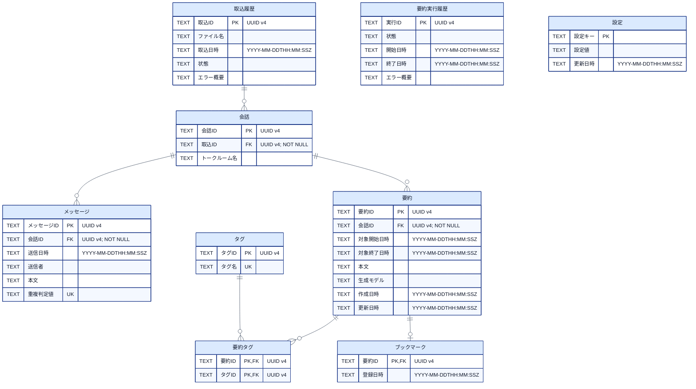
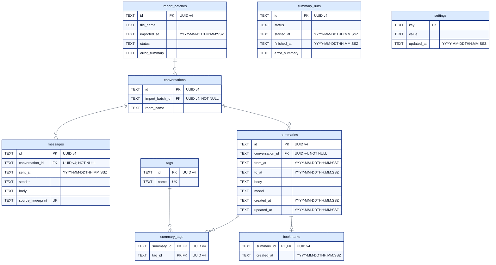
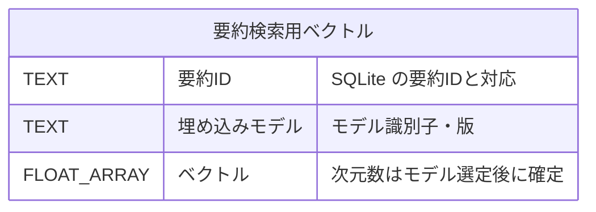
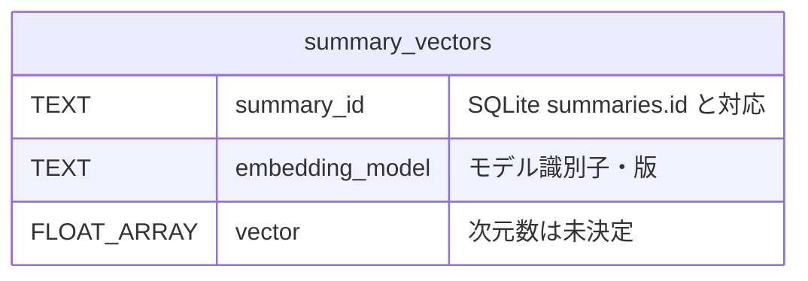

# DB 仕様書

## 保存先と責務

SQLite はトーク・要約・タグ・設定などの正本、LanceDB Embedded は要約から再構築できる検索用データを保持する。DB とマイグレーションは未実装。認証情報は通常の SQLite 設定に保存せず、Windows DPAPI で保護する方針。

## SQLite 設計

### ER 図

#### 論理名

#### 物理名

図の `UUID v4` は SQLite の型ではなく `TEXT` の値の形式。日時は UTC の ISO 8601 文字列を `TEXT` に保存する案。

----
### DB オブジェクト一覧

以下は ER 図の列を列挙した設計案。`未確定` は NULL 制約や値の規則をマイグレーション作成時に決める項目。`PK`・`FK`・`UK` は主キー・外部キー・一意制約を表す。

#### テーブル

##### `import_batches`

LINE トークファイルの取込単位と、その処理結果を記録する。

| 列 | 型 | 制約案 | 内容 |
| :--- | :--- | :--- | :--- |
| `id` | `TEXT` | PK | 取込 ID（UUID v4） |
| `file_name` | `TEXT` | 未確定 | 選択したファイル名 |
| `imported_at` | `TEXT` | 未確定 | 取込日時（UTC） |
| `status` | `TEXT` | 未確定 | 取込状態 |
| `error_summary` | `TEXT` | 未確定 | 失敗時の概要 |

##### `conversations`

取り込んだトークルームを取込履歴に紐付けて管理する。

| 列 | 型 | 制約案 | 内容 |
| :--- | :--- | :--- | :--- |
| `id` | `TEXT` | PK | 会話 ID（UUID v4） |
| `import_batch_id` | `TEXT` | FK / NOT NULL | 取込 ID |
| `room_name` | `TEXT` | 未確定 | トークルーム名 |

##### `messages`

会話に含まれるメッセージの日時、送信者、本文を保存する。

| 列 | 型 | 制約案 | 内容 |
| :--- | :--- | :--- | :--- |
| `id` | `TEXT` | PK | メッセージ ID（UUID v4） |
| `conversation_id` | `TEXT` | FK / NOT NULL | 会話 ID |
| `sent_at` | `TEXT` | 未確定 | 送信日時（UTC） |
| `sender` | `TEXT` | 未確定 | 送信者 |
| `body` | `TEXT` | 未確定 | 本文 |
| `source_fingerprint` | `TEXT` | UK | 重複判定値。生成方法は未決定 |

##### `summaries`

会話の対象期間と、Codex が生成または利用者が編集した要約本文を保存する。

| 列 | 型 | 制約案 | 内容 |
| :--- | :--- | :--- | :--- |
| `id` | `TEXT` | PK | 要約 ID（UUID v4） |
| `conversation_id` | `TEXT` | FK / NOT NULL | 会話 ID |
| `from_at` | `TEXT` | 未確定 | 対象開始日時（UTC） |
| `to_at` | `TEXT` | 未確定 | 対象終了日時（UTC） |
| `body` | `TEXT` | 未確定 | 要約本文 |
| `model` | `TEXT` | 未確定 | Codex の生成モデル |
| `created_at` | `TEXT` | 未確定 | 作成日時（UTC） |
| `updated_at` | `TEXT` | 未確定 | 更新日時（UTC） |

##### `tags`

要約の分類に使うタグ名を管理する。

| 列 | 型 | 制約案 | 内容 |
| :--- | :--- | :--- | :--- |
| `id` | `TEXT` | PK | タグ ID（UUID v4） |
| `name` | `TEXT` | UK | タグ名 |

##### `summary_tags`

要約とタグの多対多の対応を保持する。

| 列 | 型 | 制約案 | 内容 |
| :--- | :--- | :--- | :--- |
| `summary_id` | `TEXT` | PK / FK | 要約 ID |
| `tag_id` | `TEXT` | PK / FK | タグ ID |

##### `bookmarks`

利用者がブックマークした要約と登録日時を保持する。

| 列 | 型 | 制約案 | 内容 |
| :--- | :--- | :--- | :--- |
| `summary_id` | `TEXT` | PK / FK | 要約 ID |
| `created_at` | `TEXT` | 未確定 | 登録日時（UTC） |

##### `summary_runs`

手動または定期要約の実行状態と結果を記録する。

| 列 | 型 | 制約案 | 内容 |
| :--- | :--- | :--- | :--- |
| `id` | `TEXT` | PK | 実行 ID（UUID v4） |
| `status` | `TEXT` | 未確定 | 処理状態 |
| `started_at` | `TEXT` | 未確定 | 開始日時（UTC） |
| `finished_at` | `TEXT` | 未確定 | 終了日時（UTC） |
| `error_summary` | `TEXT` | 未確定 | 失敗時の概要 |

##### `settings`

秘密情報を含まないアプリ設定をキーと値で保存する。

| 列 | 型 | 制約案 | 内容 |
| :--- | :--- | :--- | :--- |
| `key` | `TEXT` | PK | 設定名。UUID ではない |
| `value` | `TEXT` | 未確定 | 秘密情報を含まない値 |
| `updated_at` | `TEXT` | 未確定 | 更新日時（UTC） |

#### 外部キー

| From | To | 説明 |
| :--- | :--- | :--- |
| `conversations.import_batch_id` | `import_batches.id` | 会話の取込履歴 |
| `messages.conversation_id` | `conversations.id` | メッセージの会話 |
| `summaries.conversation_id` | `conversations.id` | 要約の会話 |
| `summary_tags.summary_id` | `summaries.id` | タグ付け対象の要約 |
| `summary_tags.tag_id` | `tags.id` | 要約に付けるタグ |
| `bookmarks.summary_id` | `summaries.id` | ブックマーク対象の要約 |

削除時の動作と索引は未決定。スキーマ変更は `migrations/` で管理する。

## LanceDB 設計

### 論理名 ER 図

単一オブジェクトを示す図で、LanceDB 内にリレーションはない。`FLOAT_ARRAY` は概念上の表記で、実際の保存型はモデル選定後に決める。

### 物理名 ER 図

SQLite と LanceDB の間にも外部キー制約はない。

### DB オブジェクト一覧

#### `summary_vectors` テーブル

SQLite の要約 ID に対応する、意味検索用のベクトルを保存する。

| 列 | 型の案 | 内容 |
| :--- | :--- | :--- |
| `summary_id` | 文字列 | SQLite `summaries.id` と同じ UUID。検索結果の照合に使う |
| `embedding_model` | 文字列 | ベクトル生成に使ったモデルの識別子・版 |
| `vector` | 固定長の浮動小数点配列 | 要約の検索用ベクトル。次元数は未決定 |

LanceDB は SQLite の要約から再構築できる。要約の編集・削除とモデル変更時は検索用データを更新または再構築する。要約 1 件につきベクトル 1 件が初期案で、長文の分割方法は未決定。

## 未決事項

LINE ファイルの重複判定、会話と要約の単位、各列の NULL 制約、削除時の参照動作、索引、Embedding モデルとベクトル次元、バックアップ・復元手順。
