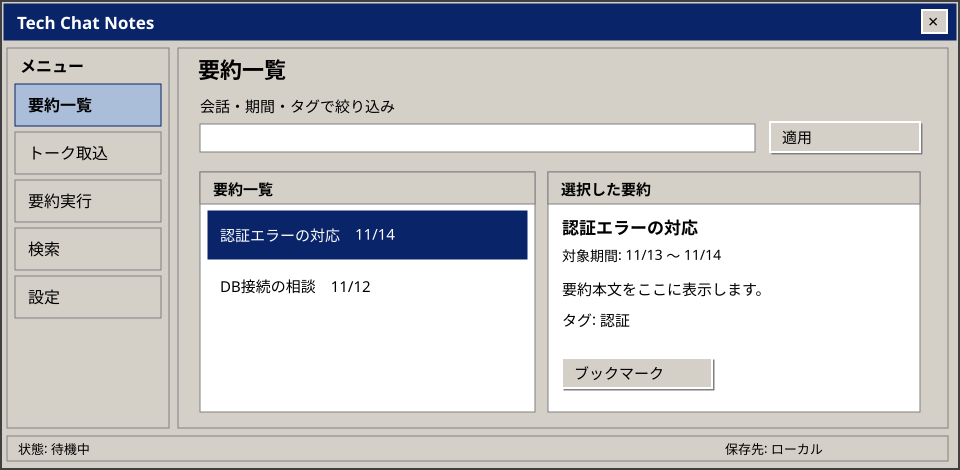
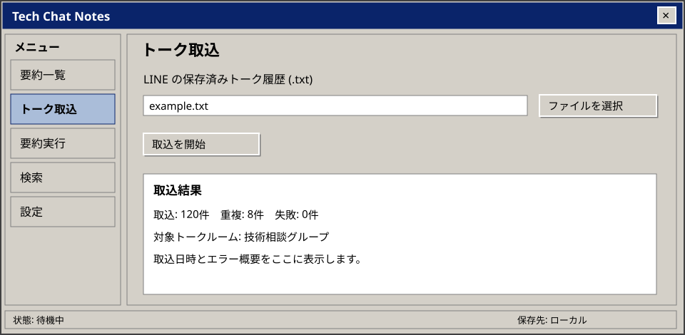
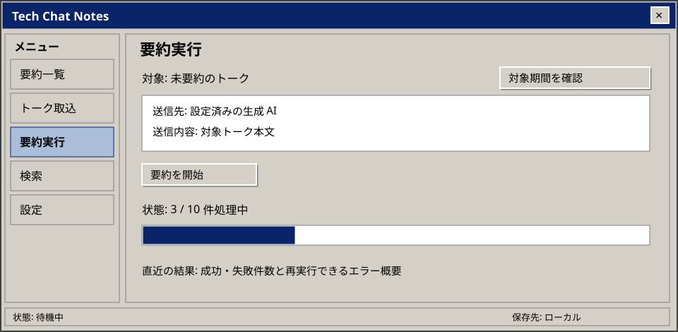
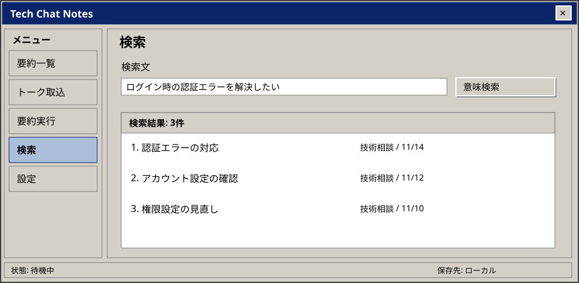

# 画面仕様書

## 位置付け

[機能要件](../requirements/機能要件・非機能要件.md)と[システム構成図](../requirements/システム構成図.md)に基づく実装前の仕様案。現在実装されているのは開発用の起動画面のみ。文言、入力形式、配置は実データと操作確認後に確定する。

## 共通構成

- Windows の単一メインウィンドウで、取込・要約実行・要約一覧・検索・設定を切り替える。ファイル選択と確認にはダイアログを使う。
- 画面はローカル HTTP API を通じて `application` 層へ操作を依頼し、SQLite、LanceDB、Codex を直接呼び出さない。
- 時間のかかる処理中も画面操作を受け付ける。進捗と完了・失敗を表示し、バックグラウンド処理からの画面更新は GUI スレッドで行う。
- 利用者向けエラーには対象の操作と再試行方法を示す。トーク本文と認証情報をログやエラー詳細に含めない。

## 画面と操作

| 画面 | 主な表示・入力 | 操作と結果 | 主な状態 |
| :--- | :--- | :--- | :--- |
| トーク取込 | 選択ファイル、取込件数、失敗概要 | `.txt` を選択して取込を開始し、結果を表示する | 未選択、処理中、成功、失敗 |
| 要約実行 | 対象期間・件数、Codex への送信先と送信範囲、進捗 | 送信内容を確認して手動実行し、保存結果を表示する | 対象なし、確認待ち、処理中、成功、失敗 |
| 要約一覧・詳細 | 要約本文、期間、タグ、ブックマーク | 要約を選び、編集・削除・分類する | 一覧、選択中、空、保存中、失敗 |
| 検索 | 検索文、候補の順位と要約 | 検索文を入力し、結果から要約詳細を開く | 未入力、検索中、結果あり、結果なし、失敗 |
| 設定 | Codex の接続状態、送信先、データ保存先、Embedding モデル、参考要約の期間と最大件数 | 接続情報と設定を確認・変更する | 未設定、設定済み、保存中、失敗 |

### 画面モック（初期案）

以下は配置と操作の流れを共有するための簡易モック。文言、寸法、色、ウィジェットの種類は実装時に調整する。

**共通レイアウトと要約一覧・詳細：** 左のメニューは固定し、右側の内容を切り替える。一覧で選んだ要約の本文とタグを同じ画面に表示する。

**トーク取込：** ファイルを選んで取込を開始し、結果を同じ領域で確認する。

**要約実行：** 外部 AI に送る対象と処理状態を表示する。実行前に送信内容を確認できるようにする。

**検索：** 入力した文をローカルでベクトル化し、結果を一覧で表示する。結果を選ぶと要約詳細を開く。

**設定：** 要約用 AI の接続情報とデータの保存場所を確認する。秘密情報は登録状態のみを示す。

## 画面ごとの確認事項

- **取込：** 有効な行を保存し、不正行を保存せずに件数を示す。重複はエクスポートに含まれるオプチャ名・書き込み時間・書き込んだ人の表示名・書き込み内容の組み合わせで判定する。文字コードと日時などの正規化方法は未決定。形式不明の場合は内容を勝手に補完しない。
- **要約実行：** 利用者がダウンロード・配置した Codex CLI で実行し、画面のボタンから OAuth 認証を開始する方針。CLI の指定・呼出し・認証連携の詳細と定期実行時の送信確認方法は未決定。
- **一覧・詳細：** 本文変更時は変更した要約自身を再ベクトル化する。失敗時は検索反映を未完了とする。要約削除時は検索データも削除する。定期処理は手編集済み要約を上書きせず、利用者が明示的に再要約した場合に限り上書きする。タグとブックマークの保存先は SQLite。
- **検索：** 意味検索は要約を対象とする。キーワード検索の初期実装範囲は未決定。Embedding モデルは未決定。
- **設定：** 認証情報の平文を再表示しない。保護方法は Windows DPAPI を方針とする。

## 追加の確定動作

- 取込では本文の改行を扱い、不正行ごとに
  `xxx行目：パースが失敗したため読み取れませんでした。` と画面に表示する。
  行番号は元ファイルの 1 行目を 1 とし、エラー文に本文を含めない。
- 再要約は対象範囲の追加メッセージも含める。手編集した要約は自動更新から保護し、
  明示的に再要約した後も保護を維持する。
- AI 生成要約の原文を内部に保持し、「AI の要約に戻す」操作で復元できるようにする。
  復元は外部 AI を呼び出さず、自動更新保護も解除しない。
- 手動の要約が実行中の場合、その回の定期要約は開始しない。
- 取込・要約の日付境界は日本時間 0 時。午前は 0:00〜12:00 未満、午後は 12:00〜翌日 0:00 未満。
  同じオプチャ名・同じ日本日付・同じ午前／午後を取込回数によらずまとめる。
  同名の別オプチャは同一と扱う制約を取込時に示す。
  定期処理は前日までを対象とし、当日分は手動のみで扱う。
- 中断ジョブが残っている場合は起動時に「再開しますか？」と表示し、利用者が選択する。
  選択なしに自動再開しない。
- 再開時は完了済みの要約単位を飛ばし、未完了の単位から進める。
  AI へ送信中だった単位を再送信する前には、利用者へ確認する。
- 参考検索で近傍候補がない場合は参考なしで続行する。ベクトル DB への接続・検索エラーでは
  要約処理を停止し、候補なしとは異なるエラーとして表示する。
- 検索反映が未完了の過去要約は参考候補から除外する。初回の複数単位要約は古い順に進め、
  各単位の初回ベクトル生成が成功してから次へ進む。
- 検索反映が未完了の要約は利用者の意味検索結果からも除外する。
  SQLite の要約本文は一覧・詳細で表示する。
- 過去の AI 原文を世代選択する一般向け機能は設けない。内部は数世代を保持できる設計とする。
- 要約本文の保存が成功してベクトル生成だけ失敗した場合、本文を表示し、
  要約を「完了」、検索への反映を「未完了」と表示する。後続の一括要約はその単位で停止する。
- 新規要約は初回ベクトル生成まで実行する。既存要約の手編集・再要約・AI 原文への復元後は、
  変更した要約自身を再ベクトル化する。参考にした後続日の要約は連鎖更新しない。
- 「検索データを再生成」は SQLite に保存済みの表示用要約本文からベクトルを作る。
- 要約削除時には、その要約へのタグ付けとブックマークも削除する。

## 実装前に決めること

画面の確定文言、日時と件数の表示形式、取り消し操作、キーボード操作、Codex 接続設定、要約の確認手順、検索結果の表示件数。
要約は午前／午後ごとに保存し、過去の関連情報を参考として渡す。送信範囲の表示には参考情報も含める。
参考要約は同じオプチャ名から意味検索で選び、対象日の前日から過去 7 日間・最大 5 件を初期値とする。
設定画面で「参考要約を探す期間（日）」「参考要約の最大件数」を正の整数として変更できる。
変更は次の要約・再要約から適用する。実行前の送信範囲に選定した参考要約の日付と件数を示す。
参考要約の類似度しきい値・順位付け方式・分量上限、期間と件数の上限も UI から変更できる方針。
各項目の単位・選択肢・初期値・許容範囲、内部の AI 原文の保持世代数、中断時の再開単位は未決定。
