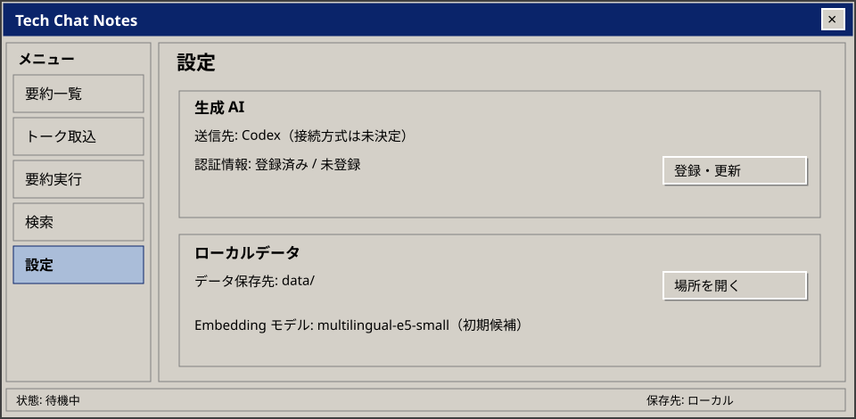

# 画面仕様書

## 位置付け

[機能要件](../requirements/機能要件・非機能要件.md)と[システム構成図](../requirements/システム構成図.md)に基づく実装前の仕様案。現在実装されているのは開発用の起動画面のみ。文言、入力形式、配置は実データと操作確認後に確定する。

## 共通構成

- Windows の単一メインウィンドウで、取込・要約実行・要約一覧・検索・設定を切り替える。ファイル選択と確認にはダイアログを使う。
- 画面はローカル HTTP API を通じて `application` 層へ操作を依頼し、SQLite、LanceDB、Codex を直接呼び出さない。
- 時間のかかる処理中も画面操作を受け付ける。進捗と完了・失敗を表示し、バックグラウンド処理からの画面更新は GUI スレッドで行う。
- 利用者向けエラーには対象の操作と再試行方法を示す。トーク本文と認証情報をログやエラー詳細に含めない。

## 画面と操作

| 画面 | 主な表示・入力 | 操作と結果 | 主な状態 |
| :--- | :--- | :--- | :--- |
| トーク取込 | 選択ファイル、取込件数、失敗概要 | `.txt` を選択して取込を開始し、結果を表示する | 未選択、処理中、成功、失敗 |
| 要約実行 | 対象期間・件数、Codex への送信先と送信範囲、進捗 | 送信内容を確認して手動実行し、保存結果を表示する | 対象なし、確認待ち、処理中、成功、失敗 |
| 要約一覧・詳細 | 要約本文、期間、タグ、ブックマーク | 要約を選び、編集・削除・分類する | 一覧、選択中、空、保存中、失敗 |
| 検索 | 検索文、候補の順位と要約 | 検索文を入力し、結果から要約詳細を開く | 未入力、検索中、結果あり、結果なし、失敗 |
| 設定 | Codex の接続状態、送信先、データ保存先、Embedding モデル | 接続情報と設定を確認・変更する | 未設定、設定済み、保存中、失敗 |

### 画面モック（初期案）

以下は配置と操作の流れを共有するための簡易モック。文言、寸法、色、ウィジェットの種類は実装時に調整する。

**共通レイアウトと要約一覧・詳細：** 左のメニューは固定し、右側の内容を切り替える。一覧で選んだ要約の本文とタグを同じ画面に表示する。

**トーク取込：** ファイルを選んで取込を開始し、結果を同じ領域で確認する。

**要約実行：** 外部 AI に送る対象と処理状態を表示する。実行前に送信内容を確認できるようにする。

**検索：** 入力した文をローカルでベクトル化し、結果を一覧で表示する。結果を選ぶと要約詳細を開く。

**設定：** 要約用 AI の接続情報とデータの保存場所を確認する。秘密情報は登録状態のみを示す。

## 画面ごとの確認事項

- **取込：** LINE `.txt` の文字コード・日時・重複判定は実ファイル確認後に決める。形式不明の場合は内容を勝手に補完しない。
- **要約実行：** Codex への接続方式・認証方式、送信対象の選び方、定期実行時の確認方法は未決定。
- **一覧・詳細：** 要約を編集・削除した場合、検索用ベクトルも更新または再構築する。タグとブックマークの保存先は SQLite。
- **検索：** 意味検索は要約を対象とする。キーワード検索の初期実装範囲は未決定。Embedding モデルは未決定。
- **設定：** 認証情報の平文を再表示しない。保護方法は Windows DPAPI を方針とする。

## 実装前に決めること

画面の確定文言、日時と件数の表示形式、取り消し操作、キーボード操作、Codex 接続設定、要約の確認手順、検索結果の表示件数。
