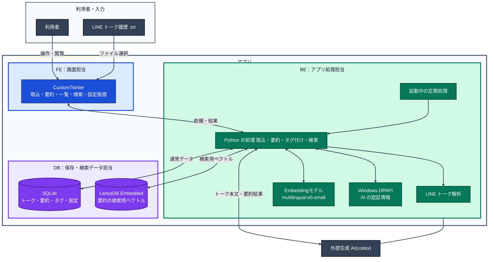
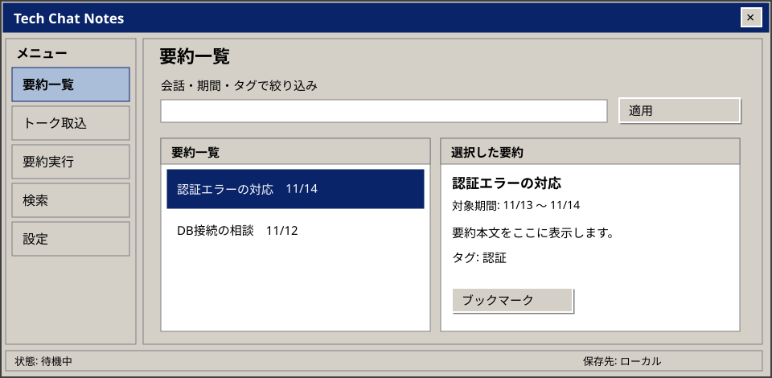
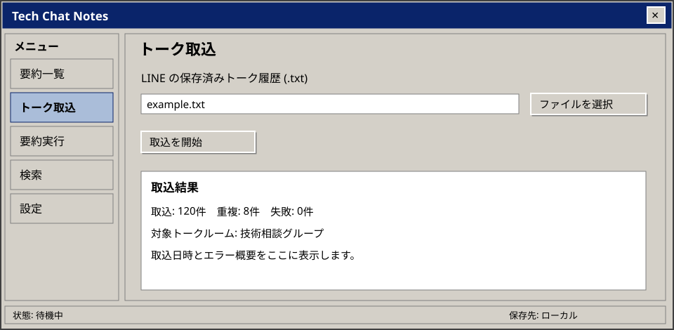
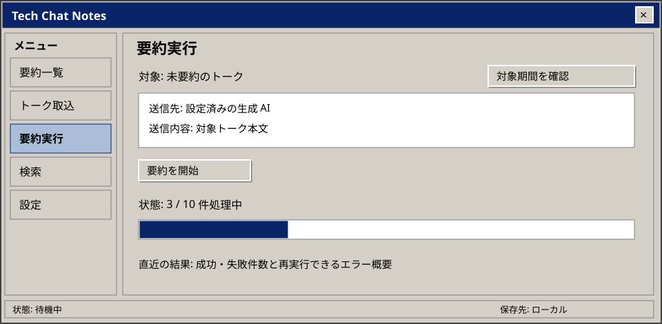
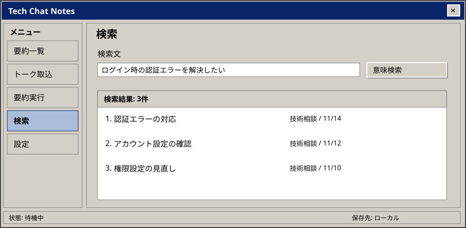
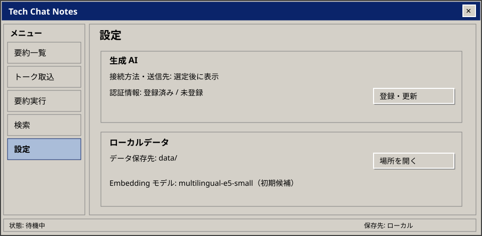
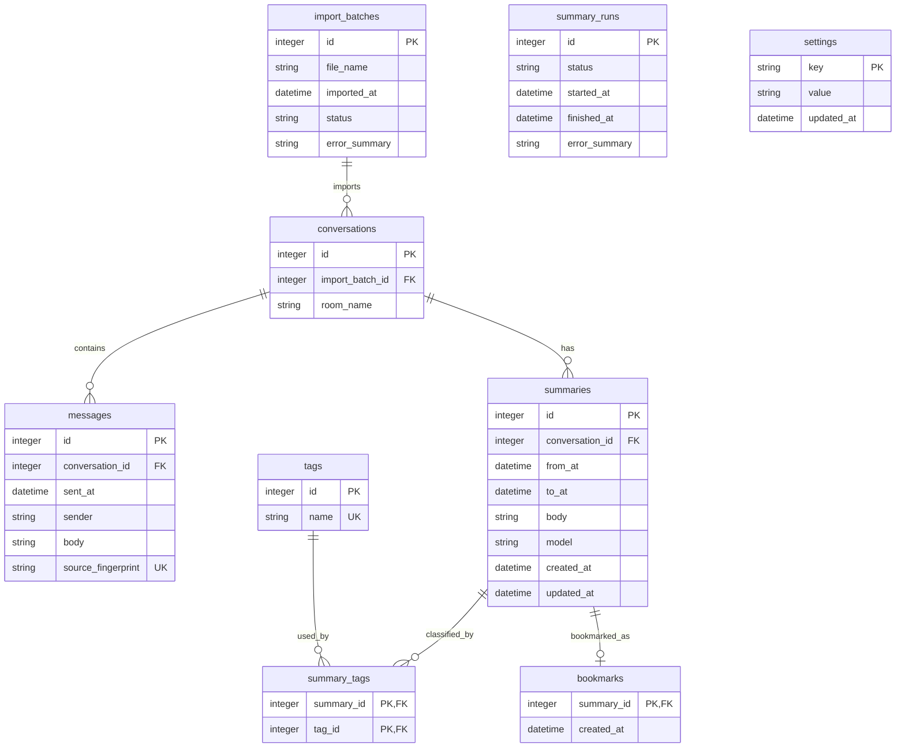
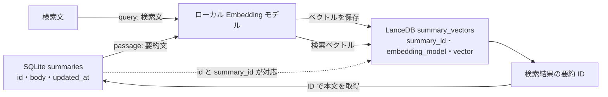

# システム構成図

画面（FE）、アプリ内の処理（BE）、データ保存（DB）の担当範囲と各領域の設計案を示します。
[機能要件・非機能要件](./機能要件・非機能要件.md)と[技術スタック選定・システム構成](./技術スタック選定・システム構成.md)を前提とした記載です。

## 1. 全体構成図



「アプリ」の外枠に FE・BE・DB を含め、利用者・トーク履歴・外部生成 AI は枠外に示す。FE・BE・DB は担当範囲を示す区分で、別々のサーバーではない。すべて Windows の portable アプリ内で動く。配布には PyInstaller を使う方針。外部通信は要約用の生成 AI への送信を想定し、Embedding とベクトル検索はローカルで行う。

| 区分 | 主な責務 | 担当間の境界 |
| :--- | :--- | :--- |
| フロントエンド | 操作、入力確認、一覧・詳細・進捗・エラー表示 | BE に処理を依頼し、結果を表示する |
| バックエンド | トーク解析、処理順序、要約、Embedding、定期処理、認証情報の利用 | FE と DB の間で処理を組み立てる |
| データベース | SQLite のスキーマ・移行・制約、LanceDB のデータ形式・検索・再構築 | SQLite を通常データの正本とし、LanceDB は再生成できる検索データにする |

## 2. FE：画面設計案

**技術：** Python と CustomTkinter。表形式の表示で不足する部品があれば ttk との併用を検討する。

メインウィンドウを一つだけ開き、左側のメニューから中央の表示を切り替える。ファイル選択や確認にはダイアログを使うが、機能ごとの別ウィンドウは作らない方針。

| 画面 | 利用者の操作 | BE とのやり取り |
| :--- | :--- | :--- |
| トーク取込 | `.txt` を選択し、取込結果を確認する | ファイルパスを渡し、件数やエラーを受け取る |
| 要約一覧・詳細 | 要約を閲覧し、タグ・ブックマークを操作する | 一覧・本文・分類情報を取得・更新する |
| 要約実行 | 手動実行と進捗確認を行う | 実行を依頼し、状態を受け取る |
| 検索 | 検索文を入力し、近い要約を開く | 検索結果の順位と本文を受け取る |
| 設定 | AI の送信先と送信内容を確認し、認証情報を登録する | BE に設定変更を依頼する |

### 画面モック（初期案）

以下は配置と操作の流れを共有するための簡易モック。文言、寸法、色、ウィジェットの種類は実装時に調整する。

**共通レイアウトと要約一覧・詳細：** 左のメニューは固定し、右側の内容を切り替える。一覧で選んだ要約の本文とタグを同じ画面に表示する。



**トーク取込：** ファイルを選んで取込を開始し、結果を同じ領域で確認する。



**要約実行：** 外部 AI に送る対象と処理状態を表示する。実行前に送信内容を確認できるようにする。



**検索：** 入力した文をローカルでベクトル化し、結果を一覧で表示する。結果を選ぶと要約詳細を開く。



**設定：** 要約用 AI の接続情報とデータの保存場所を確認する。秘密情報は登録状態のみを示す。



AI 呼び出しや大量の Embedding 処理は画面操作を塞がない形で実行し、進捗と失敗を表示する。

----
# ここから下は記載途中です
----

## 3. BE：バックエンド処理

**技術：** Python。バックエンドは画面からの依頼を受け、次の処理を行う。

| 処理 | 概要 |
| :--- | :--- |
| トーク取込 | LINE の `.txt` を解析し、形式と重複を確認して SQLite に保存する |
| 要約実行 | 未要約トークを選び、送信内容を確認したうえで外部生成 AI に依頼し、結果と実行履歴を保存する |
| 定期処理 | アプリ起動中に未要約トークを確認し、要約処理を開始する |
| 要約・分類管理 | 要約の閲覧・編集・削除、タグとブックマークの更新を行う |
| ベクトル生成 | ローカル Embedding モデルで要約文を変換し、LanceDB のデータを追加・更新・削除する |
| 意味検索 | 検索文をローカルでベクトル化し、LanceDB で近い要約 ID を探して SQLite の本文を取得する |
| 設定・認証情報 | 秘密でない設定を保存し、AI の認証情報を Windows DPAPI で保護する |
| エラー・復旧 | 失敗状態を記録し、再実行や SQLite からのベクトル再構築に対応する |

## 4. フォルダ構成

以下は FE・BE・DB の担当箇所を示すソースとデータの配置案で、現時点では未作成。

```text
src/tech_chat_notes/             # 提案するパッケージ構成。現時点では未作成
├─ main.py                      # 起動と依存の組み立て
├─ ui/                          # FE 担当：画面と表示用の状態
│  ├─ import_view.py
│  ├─ summary_view.py
│  ├─ summarize_view.py
│  ├─ search_view.py
│  └─ settings_view.py
├─ application/                 # BE 担当：操作ごとの処理
│  ├─ import_chat.py
│  ├─ summarize.py
│  ├─ manage_summaries.py
│  └─ search_summaries.py
├─ domain/                      # BE 担当：メッセージ・要約などのデータ型
├─ infrastructure/              # BE と DB の接続部分
│  ├─ line_parser.py
│  ├─ ai_client.py
│  ├─ local_embedder.py
│  ├─ credentials.py
│  ├─ sqlite_repository.py
│  └─ lancedb_repository.py
└─ scheduler.py                 # BE 担当：起動中の定期実行
migrations/                     # DB 担当：SQLite のスキーマ変更
models/                         # 配布する Embedding モデル
data/                           # 実行時に作成する利用者データ。Git に含めない
├─ app.sqlite
└─ lancedb/
```

`ui` は `application` の処理を呼び、`application` は具体的な保存操作を `infrastructure` に任せる。DB 担当は `migrations` と保存形式を定義し、BE 担当と読み書きの契約を合わせる。

## 5. DB：SQLite の設計案

**技術：** Python 標準の `sqlite3` とローカルの SQLite ファイル。トーク・要約・タグ・ブックマーク・処理履歴・秘密情報を含まない設定を保存し、スキーマは SQL マイグレーションで管理する。



ER 図中の英語名を物理名とし、対応する日本語の論理名を以下に示す。物理名は実装時のテーブル・カラム名の案であり、まだ SQL スキーマは作成していない。

| 論理テーブル名 | 物理テーブル名 | 主な論理カラム名（物理カラム名） |
| :--- | :--- | :--- |
| 取込履歴 | `import_batches` | 取込ID (`id`)、ファイル名 (`file_name`)、取込日時 (`imported_at`)、状態 (`status`)、エラー概要 (`error_summary`) |
| 会話 | `conversations` | 会話ID (`id`)、取込ID (`import_batch_id`)、トークルーム名 (`room_name`) |
| メッセージ | `messages` | メッセージID (`id`)、会話ID (`conversation_id`)、送信日時 (`sent_at`)、送信者 (`sender`)、本文 (`body`)、重複判定値 (`source_fingerprint`) |
| 要約 | `summaries` | 要約ID (`id`)、会話ID (`conversation_id`)、対象開始日時 (`from_at`)、対象終了日時 (`to_at`)、本文 (`body`)、生成モデル (`model`)、作成日時 (`created_at`)、更新日時 (`updated_at`) |
| タグ | `tags` | タグID (`id`)、タグ名 (`name`) |
| 要約・タグ関連 | `summary_tags` | 要約ID (`summary_id`)、タグID (`tag_id`) |
| ブックマーク | `bookmarks` | 要約ID (`summary_id`)、登録日時 (`created_at`) |
| 要約実行履歴 | `summary_runs` | 実行ID (`id`)、状態 (`status`)、開始日時 (`started_at`)、終了日時 (`finished_at`)、エラー概要 (`error_summary`) |
| 設定 | `settings` | 設定キー (`key`)、設定値 (`value`)、更新日時 (`updated_at`) |

ER 図は[初期データモデル案](./技術スタック選定・システム構成.md)を関係として表したもの。`summary_runs` と `settings` は独立した管理テーブル。`messages.source_fingerprint` の一意制約で重複を防ぐ案だが、識別値の作り方と複数ファイルにまたがる会話の扱いは未決定。API キーは SQLite に平文で保存しない。

## 6. ベクトル DB：LanceDB の設計案

**技術：** ローカルの LanceDB Embedded と[ローカル Embedding モデル](./ローカルEmbeddingモデル選定.md)。LanceDB は意味検索用のデータを保持し、要約本文と管理情報は SQLite に置く。

複数テーブルの関係を示す ER 図に相当するものとして、検索用テーブルのスキーマと SQLite への対応を示す。



| `summary_vectors` の列 | 役割 |
| :--- | :--- |
| `summary_id` | SQLite の `summaries.id` に対応する識別子 |
| `embedding_model` | ベクトルを生成したモデルの識別子・版 |
| `vector` | 要約文から得た固定長の数値列。初期候補は 384 次元 |

初期案は**要約 1 件につきベクトル 1 件**とする。入力上限を超える要約の分割方法は未決定で、分割する場合は `chunk_id` などを追加して複数ベクトルにする。LanceDB は SQLite と外部キーを共有しないため、BE が要約の編集・削除に合わせて更新する。不整合やモデル変更時には SQLite の要約から再構築する。検索時は同じモデルを使い、E5 の指定に従って要約に `passage: `、検索文に `query: ` を付ける。

## 7. 実装前に決めること

- LINE 保存ファイルの形式差、重複識別値、複数取込と会話の対応。
- 要約の単位と、入力上限を超える要約の分割・ベクトル保持方法。
- 日本語の実データを使ったモデルの精度、CPU 上の速度、Windows 配布物での動作。
- 外部生成 AI の事業者・接続方法、送信範囲、認証情報の登録方法。
- 定期処理の間隔、バックアップ・復元の手順。

## 参考資料

- [CustomTkinter](https://github.com/TomSchimansky/CustomTkinter)
- [Python sqlite3](https://docs.python.org/3/library/sqlite3.html)
- [LanceDB Embedded](https://docs.lancedb.com/)
- [Multilingual E5 small モデルカード](https://huggingface.co/intfloat/multilingual-e5-small)
