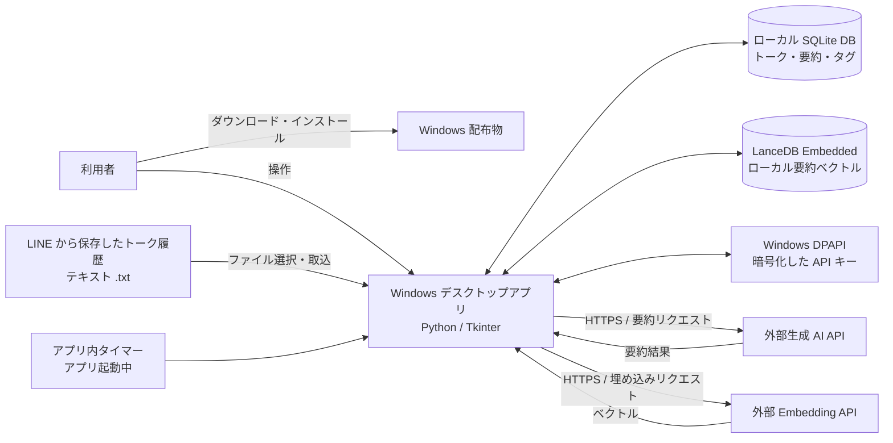

# 技術スタック選定・システム構成

## 1. 目的

「[機能要件・非機能要件](./機能要件・非機能要件.md)」に定義した機能を、少人数で開発・保守しやすい Windows 向けローカルアプリとして実現するため、初期技術スタックと構成を定める。

利用者はアプリをダウンロードし、各自の PC 上で portable 形式の配布物を実行する。中央サーバーや利用者アカウントは設けず、ユーザーデータはローカルに保存する。

## 2. 前提

- 対応 OS は Windows のみ。
- LINE のトークを LINE の機能でテキスト（.txt）保存し、利用者がアプリからファイルを選んで取り込む。LINE API や LINE アカウントには接続しない。
- 要約には外部生成 AI を使う(APIかは要検討)。トーク本文を外部へ送信することを利用者に明示する。
- 定期要約はアプリ起動中に、既に取り込まれた未要約トークを対象に行う。
- AI 要約にはインターネット接続が必要。トーク取込、閲覧、タグ付けなどはローカルで行う。

## 3. 技術スタック

採用不採用は決定しました。
不採用のものも勉強のため残しました。

### 3.1 GUI ライブラリー候補一覧

難易度は Python 初心者を含む少人数チームでの相対評価（1=易しい、5=最高難易度）。更新状況は **2026-11-08 時点で確認できた最新の安定版リリース日**とする。Tkinter / ttk は Python 標準ライブラリーのため独立した GitHub リポジトリ・バージョンがなく、スター数・Issue 数・個別リリース日は対象外。PySide6 は PyPI の配布リリース日を示す。

| 採否 | ライブラリ名 | 特徴 | メリット | デメリット | GitHub スター数 | オープン Issue | 更新状況（最新バージョンのリリース日） | 運営・スポンサー | 難易度 |
| :--- | :--- | :--- | :--- | :--- | :---: | :---: | :--- | :--- | :---: |
| 採用 | [CustomTkinter](https://github.com/TomSchimansky/CustomTkinter) | Tkinter ベースの現代的なウィジェット集。 | 角丸・ダークモード等を比較的簡単に実装できる。 | 外部依存が増える。ttk 表部品との見た目調整が必要。 | 約 13.6k | 約 297 | 6.0.0 — 2026-06-24 | 個人メンテナー中心のコミュニティ。GitHub Sponsors 表示は確認できず。 | 2/5 |
| 不採用 | Tkinter / ttk | Python 標準 GUI。Windows で使える ttk 部品も含む。 | Python に同梱され、追加 GUI 依存なし。小さいフォームを作りやすい。 | 素の見た目は古め。複雑な画面やテーマ調整は手作業が増える。 | 個別値なし | 個別値なし | 独立リリースなし（Python 標準ライブラリー） | Python コア開発者とコミュニティが保守。PSF 支援は Python 全体向け。 | 1/5 |
| 不採用 | [ttkbootstrap](https://github.com/israel-dryer/ttkbootstrap) | ttk のテーマ・ウィジェット拡張。 | Tkinter の知識を使ってテーマや表・入力部品を扱える。 | Tkinter のレイアウト知識が必要。テーマ固有設定に追従する。 | 約 2.7k | 約 1 | 2.2.7 — 2026-11-05 | 個人メンテナー主導の OSS。JetBrains の PyCharm 支援あり。 | 2/5 |
| 不採用 | [PySide6](https://github.com/pyside/pyside-setup) | Qt for Python の公式バインディング。豊富な Qt Widgets を利用可能。 | 大きな画面やテーブルを体系的に構成しやすい。 | 学ぶ API が多く、配布物も大きい。LGPL 等のライセンスと配布条件の確認が必要。 | 約 137（ミラー） | 0（ミラー上） | 6.12.0 — 2026-10-08 | Qt Group 主導の企業支援 OSS。 | 4/5 |

### 3.2 ベクトル DB 候補一覧

ここでいう「サーバレス」は、アプリのプロセス内で動き、利用者 PC にデータを保存する組込み型を指す。難易度は Python 初心者が組込み利用する場合の相対評価（1=易しい、5=最高難易度）。更新状況は **2026-11-08 時点で確認できた最新リリース日**を記載し、安定版がない場合はプレリリースと明示する。

| 採否 | ライブラリ名 | 特徴 | メリット | デメリット | GitHub スター数 | オープン Issue | 更新状況（最新バージョンのリリース日） | 運営・スポンサー | 難易度 |
| :--- | :--- | :--- | :--- | :--- | :---: | :---: | :--- | :--- | :---: |
| 採用 | [LanceDB Embedded](https://github.com/lancedb/lancedb) | Python SDK からローカルディレクトリを開く組込み DB。ベクトル・キーワード検索に対応。 | Python から直接使えて DB サーバー不要。検索データをフォルダーごと持ち運べる。 | ネイティブ依存の配布確認が必要。SQLite とは別 DB になる。 | 約 11.9k | 約 469 | 0.41.0 — 2026-10-29（安定版）。後続の beta 版あり。 | 企業支援の OSS。GitHub Sponsors 専用表示は確認できず。 | 3/5 |
| 不採用 | [sqlite-vec](https://github.com/asg017/sqlite-vec) | SQLite にベクトル検索機能を加える拡張。 | 通常データとベクトルを一つの SQLite ファイルにまとめやすい。 | pre-v1。拡張 DLL の同梱・ロードと PyInstaller 配布の確認が必要。 | 約 8.2k | 約 166 | 0.1.10-alpha.4 — 2026-05-18（プレリリース） | 個人メンテナーとコミュニティ。Mozilla Builders 等の支援を公開。 | 4/5 |
| 不採用 | [Chroma PersistentClient](https://github.com/chroma-core/chroma) | Python からローカルディレクトリに永続化するクライアント。 | Python API が分かりやすく、試しやすい。 | 公式資料では PersistentClient はローカル開発・テスト向け。本番配布の第一候補にはしにくい。 | 約 29.7k | 約 379 | 1.5.9 — 2026-05-05（安定版） | 企業開発の OSS。コミュニティ貢献あり。GitHub Sponsors 専用表示は確認できず。 | 2/5 |

### 3.5 アプリ構成

候補は Windows 向け portable 配布を前提に、Python GUI・SQLite・組込み型ベクトル DB・PyInstaller の組み合わせで比較する。

| 採否 | 構成 | 特長 | メリット | デメリット |
| :--- | :--- | :--- | :--- | :--- |
| 採用 | CustomTkinter + SQLite (`sqlite3`) + LanceDB Embedded + PyInstaller | モダンな見た目を優先する構成。 | 角丸・ダークモードなどを比較的簡単に実装でき、初見の印象を整えやすい。 | 一覧・表には ttk 部品等との併用が必要になる場合があり、画面全体の統一に工夫が要る。LanceDB のネイティブ依存も含め配布物が大きくなりやすい。 |
| 不採用 | Tkinter / ttk + SQLite (`sqlite3`) + LanceDB Embedded + PyInstaller | 標準 GUI と組込みベクトル DB を組み合わせる基本案。 | 追加 GUI 依存を抑え、Python 一言語で開発できる。LanceDB はベクトルとキーワード検索に対応する。 | Tkinter の画面装飾は限定的。LanceDB のネイティブ依存を配布物に含める必要があり、通常データと検索データは別 DB になる。 |
| 不採用 | ttkbootstrap + SQLite (`sqlite3`) + LanceDB Embedded + PyInstaller | Tkinter/ttk をテーマで整えた構成。 | Tkinter の知識を活かしつつ、テーマと追加ウィジェットで画面を見やすくできる。 | ttkbootstrap を追加で保守する。LanceDB の配布確認と DB 二重管理は必要。 |
| 不採用 | PySide6 + SQLite (`sqlite3`) + LanceDB Embedded + PyInstaller | Qt の GUI 部品を使う本格的なデスクトップ構成。 | 複雑な画面、表、ダイアログを体系立てて実装しやすい。 | 学習・実装の負担と配布物サイズが増える。Qt のライセンス・配布条件の確認が必要。 |
| 不採用 | Tkinter / ttk + SQLite (`sqlite3`) + sqlite-vec + PyInstaller | ベクトル検索も SQLite 拡張に集約する構成。 | 通常データとベクトルを単一 SQLite ファイルにまとめられる。 | sqlite-vec は pre-v1。拡張 DLL のロード、Windows 配布、互換性変更への対応が必要で難易度が高い。 |
| 不採用 | Tkinter / ttk + SQLite (`sqlite3`) + Chroma PersistentClient + PyInstaller | Python API の分かりやすさを優先した試作案。 | API が扱いやすく、意味検索の試作を始めやすい。 | PersistentClient は公式にローカル開発・テスト向けとされ、本番配布の第一候補にはしにくい。依存が多く配布サイズも大きくなりやすい。 |

----
# ここから下はドラフトです

### 3.6 推奨構成（Python + Tkinter 系 GUI + LanceDB）

| 領域 | 選定案 | 採用理由・補足 |
| :--- | :--- | :--- |
| 言語 | Python | UI、LINE ファイル解析、AI API 呼び出し、ベクトル DB 操作を一言語にする。 |
| UI | Tkinter / ttk（初期案）。テーマが必要なら ttkbootstrap を評価 | まずは Python 標準 GUI で構成し、必要な場合だけテーマ用依存を追加する。 |
| 通常データ | SQLite + 標準 `sqlite3` | トーク、要約、タグ、ブックマークなどの関連データを保存する。 |
| ベクトル DB | LanceDB Embedded | 要約ベクトルをローカルディレクトリに保存し、意味検索を行う。DB サーバーは起動しない。 |
| 埋め込み生成 | 外部 Embedding API（事業者未決定） | 要約文と検索語を同じモデルでベクトル化する。送信データ・費用・モデル変更に備えてプロバイダーを切り替え可能にする。 |
| API キー保護 | Windows DPAPI を使う資格情報保管 | 生成 AI / Embedding API キーを平文の設定ファイルや DB に置かない。 |
| 定期実行 | アプリ内タイマー | アプリ起動中に未要約トークを処理する。 |
| 配布 | PyInstaller の Windows portable 配布物 | Python 実行環境と必要なネイティブ依存をまとめる。実行ファイルと同じ場所にデータ用フォルダーを置き、フォルダー単位で移動・バックアップできる構成にする。 |
| CI | GitHub Actions（Windows runner） | Windows 向けビルドと静的チェックを行う。 |

### 少人数開発での方針

- Python に言語を統一し、Web フロントエンドや別言語のバックエンドを持たない。
- Web サーバー、クラウド DB、認証サービス、キューは導入しない。
- SQLite を通常データの正本とし、LanceDB には要約 ID とベクトルを保存する。ベクトル DB は再構築可能な検索用データとして扱う。
- 要約本文の編集・削除に応じてベクトルを更新する。再構築手段を用意して2つのローカル DB の不整合から復旧できるようにする。
- 埋め込みモデル名・次元数・モデル版を記録する。モデル変更時はベクトルを作り直す。
- 配布物に Python と LanceDB のネイティブ依存を含め、実行ファイルと同じフォルダー内に `data/app.sqlite` と `data/lancedb/` を作成する。アプリとデータのフォルダーをまとめて移動・バックアップできるようにする。
- DPAPI で保護した API キーは Windows ユーザーに紐づくため、別ユーザーや別 PC にデータを移した場合は API キーを再登録する。

## 4. システム構成図

アプリ実行時に中央サーバーへユーザーデータを送らず、利用者間でデータを共有しない。外部通信は生成 AI API への要約リクエストと、Embedding API への要約文・検索語の送信に限る。

## 5. 主なデータの流れ

1. 利用者が LINE でトーク履歴をテキストファイルとして保存し、アプリからファイルを選択する。
2. アプリがファイルを解析し、トークルーム・日時・送信者・本文を SQLite に保存する。
3. 利用者の手動操作またはアプリ起動中のタイマーで、未要約トークを生成 AI API に送信する。
4. 要約、タグ、ブックマーク、処理履歴を SQLite に保存する。
5. 要約を Embedding API でベクトル化し、要約 ID とベクトルを LanceDB に保存する。
6. 利用者が意味検索すると、検索文を同じ Embedding API でベクトル化し、LanceDB から近い要約 ID を取得して SQLite の要約本文を表示する。

## 6. 初期データモデル案

| テーブル | 主な項目 | 目的 |
| :--- | :--- | :--- |
| `settings` | `key`, `value`, `updated_at` | 非秘密のアプリ設定。API キーは保存しない。 |
| `import_batches` | `id`, `file_name`, `imported_at`, `status`, `error_summary` | トークファイルの取込単位と結果 |
| `conversations` | `id`, `import_batch_id`, `room_name` | 取り込んだトークルーム |
| `messages` | `id`, `conversation_id`, `sent_at`, `sender`, `body`, `source_fingerprint` | 保存トーク内のメッセージと重複判定用識別値 |
| `summaries` | `id`, `conversation_id`, `from_at`, `to_at`, `body`, `model`, `created_at`, `updated_at` | 対象期間と生成・編集済み要約 |
| `tags` | `id`, `name` | 利用者が管理する分類タグ |
| `summary_tags` | `summary_id`, `tag_id` | 要約とタグの関連 |
| `bookmarks` | `summary_id`, `created_at` | ブックマーク |
| `summary_runs` | `id`, `status`, `started_at`, `finished_at`, `error_summary` | 手動・定期の要約処理履歴 |
| LanceDB `summary_vectors` | `summary_id`, `embedding_model`, `vector` | SQLite の要約に対応する検索用ベクトル。SQLite の要約 ID を参照し、再生成可能なデータとして扱う。 |

DB スキーマは SQL マイグレーションファイルで管理する。メッセージの内容・日時などから識別値を作り、一意制約により同じファイルの再取込で重複登録しない。

## 7. セキュリティ・運用方針

- 生成 AI API キーは DPAPI で暗号化し、ログや通常の設定・DB に平文で記録しない。
- AI に送るトーク本文の範囲と送信先を利用者に示す。
- ログには処理状態とエラー概要を記録し、トーク本文や API キーを含めない。
- API 失敗時は処理状態を保存し、利用者が再実行できるようにする。
- ローカル DB のバックアップ・エクスポートと、アンインストール時のデータ保持方法を案内する。

## 8. 未決事項

| 項目 | 決定が必要な内容 |
| :--- | :--- |
| Windows 対応範囲 | 対応エディション・最低バージョン・x64 / ARM64 |
| LINE トーク形式 | 保存ファイルの文字コード・日付形式、複数トークルームを含むファイルの扱い、重複判定方法 |
| AI 事業者 | 対応モデル、利用者自身の API キーを使うか、データ保持・学習利用条件 |
| Embedding | Embedding API の事業者・モデル、利用料、ベクトル次元数、モデル更新時の再生成方法 |
| 定期処理 | 実行間隔、アプリ終了中の実行が必要か |
| データ保護 | DB の暗号化、バックアップ・エクスポート形式、削除・復元手順 |
| 配布 | portable ZIP の構成、署名、更新方法、データフォルダーの移動・バックアップ方法 |
| 検索 | SQLite 全文検索を初期実装に含めるか |

LINE の Windows 版では、トークルームのメニューから「トークを保存」でテキスト形式の履歴を保存できる。保存対象は現在のトークルームに表示されている履歴で、テキスト保存した履歴は LINE に復元できない。

## 参考資料

- [Python Tkinter](https://docs.python.org/3/library/tkinter.html)
- [Python sqlite3](https://docs.python.org/3/library/sqlite3.html)
- [CustomTkinter](https://github.com/TomSchimansky/CustomTkinter)
- [ttkbootstrap](https://github.com/israel-dryer/ttkbootstrap)
- [Qt for Python / PySide6](https://doc.qt.io/qtforpython-6/)
- [PySide6 の開発履歴](https://github.com/qtproject/pyside-pyside-setup/commits)
- [LanceDB Embedded クイックスタート](https://lance.org/quickstart/lancedb/)
- [LanceDB Python SDK](https://lancedb.github.io/lancedb/python/python/)
- [sqlite-vec](https://github.com/asg017/sqlite-vec)
- [Chroma PersistentClient](https://docs.trychroma.com/reference/python)
- [LINE ヘルプ：トーク履歴をテキスト形式（.txt）で保存するには？](https://help.line.me/line/smartphone?contentId=20007388&fid=default&fpid=fp_9dg574oemvx4h0eq&lang=ja&var=A)
